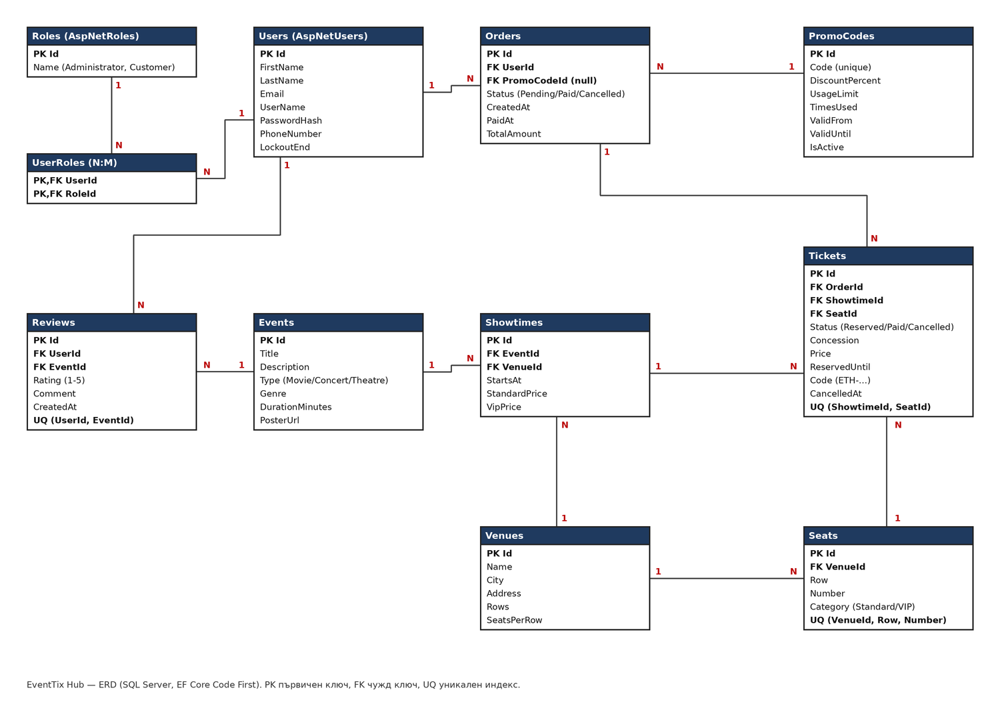

# EventTix Hub — Дизайн на проекта

Практическо задание 05: схема на базата данни (ERD) и архитектурен план на проекта „Онлайн платформа за билети за кино и концерти“ (EventTix Hub).

Екип: Кристиян (Team Lead, Back-end, UI/UX), Радостин (Front-end), Преслав (QA).
Хранилище: https://github.com/Milankata08/Eventix-Hub

## Задача 1.1: Релационен модел (ERD диаграма)

Диаграмата е изчертана по моделите в кода (`EventTixHub.Web/Models`) и първата миграция (`Data/Migrations/20261003193802_InitialCreate`). Същият модел е записан и като DBML в `docs/erd.dbml` — може да се постави в dbdiagram.io и да се редактира там.



### Същности и атрибути

Всяка таблица има първичен ключ `Id` (int, identity). Потребителите и ролите идват от ASP.NET Core Identity (`IdentityUser<int>`, `IdentityRole<int>`).

| Същност (Entity) | Атрибути и полета |
|---|---|
| User (`AspNetUsers`) | Id, FirstName, LastName, Email, UserName, PasswordHash, PhoneNumber, LockoutEnd, AccessFailedCount (+ останалите полета на Identity) |
| Role (`AspNetRoles`) | Id, Name (`Administrator`, `Customer`) |
| UserRole (`AspNetUserRoles`) | UserId, RoleId (междинна същност N:M, съставен първичен ключ) |
| Event | Id, Title, Description, Type (Movie, Concert, Theatre), Genre, DurationMinutes, PosterUrl |
| Venue | Id, Name, City, Address, Rows, SeatsPerRow |
| Seat | Id, VenueId, Row, Number, Category (Standard, Vip) |
| Showtime | Id, EventId, VenueId, StartsAt, StandardPrice, VipPrice (междинна същност между Event и Venue) |
| Order | Id, UserId, PromoCodeId (може да е празно), Status (Pending, Paid, Cancelled), CreatedAt, PaidAt, TotalAmount |
| Ticket | Id, OrderId, ShowtimeId, SeatId, Status (Reserved, Paid, Cancelled), Concession (Regular, Student, Pensioner), Price, ReservedUntil, Code (`ETH-` + 10 знака), CancelledAt |
| Review | Id, UserId, EventId, Rating (1–5), Comment (до 1000 знака), CreatedAt |
| PromoCode | Id, Code, DiscountPercent (1–100), UsageLimit, TimesUsed, ValidFrom, ValidUntil, IsActive |

Типове данни: цените и сумите са `decimal(10,2)`; датите са `datetime2`; изброимите типове (тип, статус, категория, намаление) се пазят като `int`.

### Релационни връзки

Задължителните връзки от заданието, пренесени към нашия домейн:

| Връзка от заданието | Връзка в EventTix Hub | Тип | Как е реализирана |
|---|---|---|---|
| User ↔ Role (1:N) | User ↔ Role | N:M | чрез `AspNetUserRoles` (Identity); на практика всеки потребител има точно една роля — `Customer` при регистрация, `Administrator` се дава от администратор |
| User ↔ Subscription (1:N) | User ↔ Order | 1:N | `Order.UserId` → `Users.Id` |
| Workout ↔ Exercise (N:M чрез WorkoutExercise) | Event ↔ Venue | N:M | чрез `Showtime` (събитие в зала в даден час, с цени) |
| Workout ↔ Review (1:N) | Event ↔ Review | 1:N | `Review.EventId` → `Events.Id` |

Всички връзки:

| Родител | Дете | Тип | Чужд ключ | При изтриване на родителя |
|---|---|---|---|---|
| User | Order | 1:N | Order.UserId | забранено (Restrict) |
| User | Review | 1:N | Review.UserId | каскадно |
| User ↔ Role | UserRole | N:M | UserRole.UserId, UserRole.RoleId | каскадно |
| Event | Showtime | 1:N | Showtime.EventId | каскадно (услугата първо отказва при продадени билети) |
| Event | Review | 1:N | Review.EventId | каскадно |
| Venue | Seat | 1:N | Seat.VenueId | каскадно |
| Venue | Showtime | 1:N | Showtime.VenueId | забранено (Restrict) |
| Showtime | Ticket | 1:N | Ticket.ShowtimeId | забранено (Restrict) |
| Seat | Ticket | 1:N | Ticket.SeatId | забранено (Restrict) |
| Order | Ticket | 1:N | Ticket.OrderId | забранено (Restrict) |
| PromoCode | Order | 1:N | Order.PromoCodeId (nullable) | забранено (Restrict) |

Билетите и поръчките никога не се изтриват каскадно: изтриване, което би засегнало продаден билет, се отказва със съобщение.

### Ограничения и индекси

| Ограничение | Цел |
|---|---|
| Уникален (ShowtimeId, SeatId) върху билети със Status ≠ Cancelled | едно място не може да се продаде два пъти, дори при едновременни заявки |
| Уникален UserId върху поръчки със Status = Pending | една количка на потребител |
| Уникален (VenueId, Row, Number) | едно място в зала съществува веднъж |
| Уникален (UserId, EventId) в Reviews | едно ревю на потребител за събитие |
| Уникален Code в PromoCodes; уникален Code в Tickets (когато не е празен) | промо кодът и кодът на билета се търсят еднозначно |
| Concurrency token върху Ticket.Status, Order.Status, PromoCode.TimesUsed | двойно натискане или едновременно плащане не записва нищо два пъти |

## Задача 1.2: Архитектурен план

Проектът следва N-слойна архитектура (Layered Architecture). Решението `EventTixHub.sln` има два проекта: уеб приложението `EventTixHub.Web` и тестовете `EventTixHub.Tests`. Слоевете са отделени по папки и пространства от имена в уеб проекта — за проект с този размер това дава същото разделение без отделни сборки (assemblies). Всеки слой зависи само от слоя под него.

```
Представяне (Controllers, Areas/Admin, Views, ViewModels, Api)
        │  вика услуги, никога базата пряко
        ▼
Бизнес слой (Services: 8 услуги + BookingRules)
        │  работи през IRepository<T>
        ▼
Слой хранилище (Data/IRepository.cs, Data/Repository.cs)
        │  EF Core
        ▼
Слой данни (Models, ApplicationDbContext, Migrations, DbSeeder)
        │
        ▼
SQL Server LocalDB
```

| Слой (по заданието) | В EventTix Hub | Съдържание |
|---|---|---|
| Data Layer | `EventTixHub.Web.Models`, `EventTixHub.Web.Data` | класовете модели (`Event`, `Venue`, `Seat`, `Showtime`, `Order`, `Ticket`, `Review`, `PromoCode`, `User`, `Role`, общ `BaseEntity`, изброими типове в `Enums.cs`); контекстът `ApplicationDbContext` (ключове, индекси, поведение при изтриване); EF Core миграциите; демо данните `DbSeeder` |
| Repository Layer | `Data/IRepository.cs`, `Data/Repository.cs` | родов интерфейс `IRepository<T>` и реализацията `Repository<T>` — абстракция над EF Core; регистриран в DI за всеки тип: `AddScoped(typeof(IRepository<>), typeof(Repository<>))`; `Query()` връща `IQueryable<T>`, върху който услугите филтрират и странират (`ToPagedResultAsync` → `PagedResult<T>`) |
| Business Layer | `EventTixHub.Web.Services` | бизнес логиката: `EventService`, `VenueService`, `TicketService`, `OrderService`, `PromoCodeService`, `ReviewService`, `UserService`, `ReportService`; чистите правила за цени, статуси и срокове в `BookingRules`; грешките на бизнес правилата като `BookingException` с текст на български |
| Presentation Layer | `Controllers`, `Areas/Admin`, `Views`, `ViewModels`, `Controllers/Api` | MVC контролери и Razor изгледи, админ област, REST API със Swagger; контролерът проверява формата, вика услуга и показва резултата |
| Тестове | `EventTixHub.Tests` | xUnit, Moq, SQLite in-memory: модулни тестове на `BookingRules` и услугите, интеграционни тестове на хранилището и пълния път на покупката |

**Правила между слоевете**

- Контролерите не използват `ApplicationDbContext` — само услуги.
- Услугите получават `IRepository<T>` и `TimeProvider` чрез конструктора (Dependency Injection), затова се тестват с фалшиво хранилище и фалшив часовник.
- `BookingRules` е статичен клас без база и без системен часовник — всички изчисления на цени, намаления, промо кодове, статус на място и срокове са там и се тестват директно.
- Един запис в базата (`SaveChangesAsync`) в края на всяка операция — всичко или нищо.

**Технологии:** C# и .NET 9, ASP.NET Core MVC, ASP.NET Core Identity, Entity Framework Core 9 (Code First), SQL Server LocalDB, Razor, Bootstrap 5, JavaScript (AJAX), QRCoder, Swashbuckle (Swagger), xUnit, Moq.
