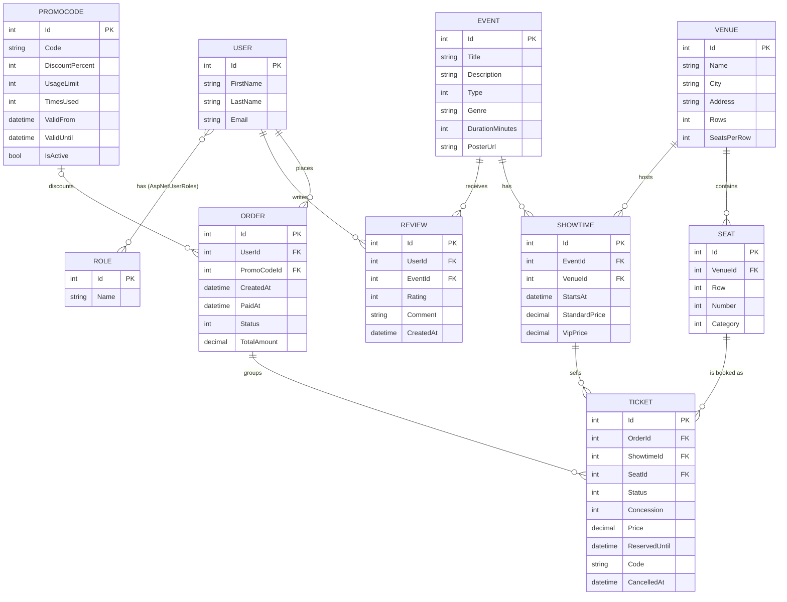
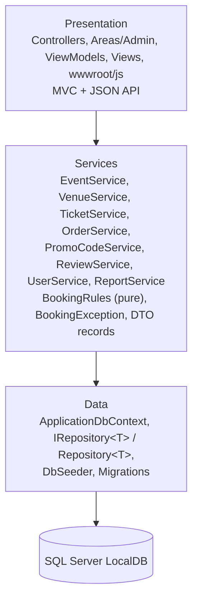
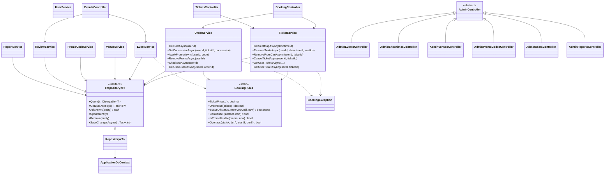
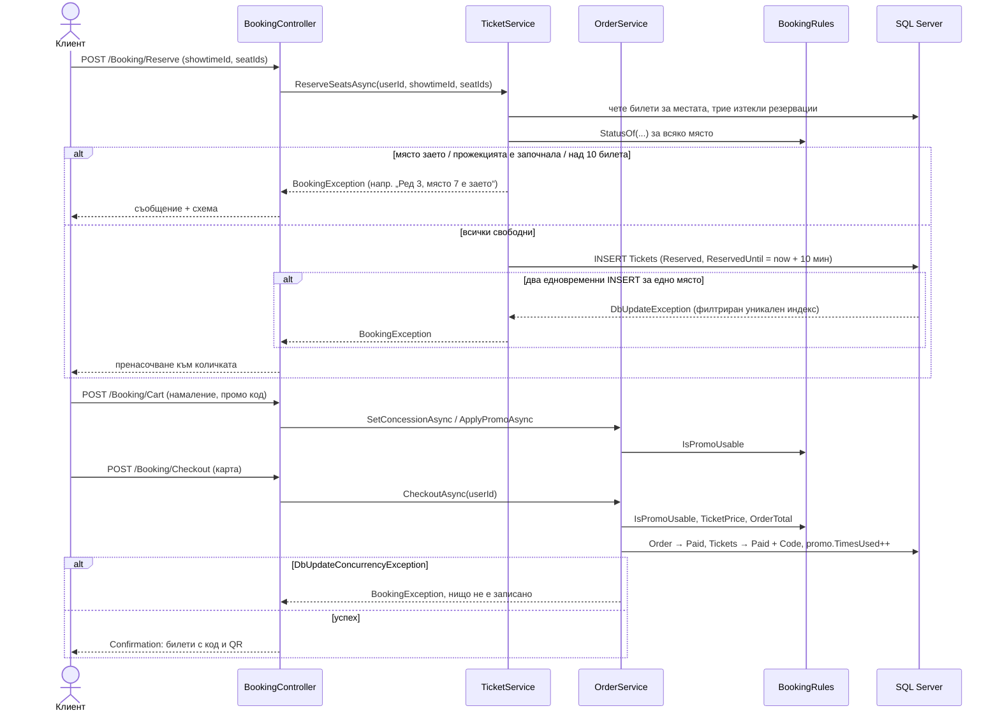

# EventTix Hub — Документация

Онлайн платформа за билети за кино, концерти и театър. ASP.NET Core MVC (.NET 9) + EF Core + SQL Server LocalDB + ASP.NET Core Identity.

Съдържание: 1 Описание · 2 Функционални изисквания · 3 Роли и права · 4 База данни · 5 ER диаграма · 6 Архитектура · 7 Основни страници · 8 Бизнес правила · 9 Тестови сценарии · 10 Инструкции за стартиране.

---

## 1. Описание на системата

EventTix Hub позволява на зрители да разглеждат афиш от събития (филми, концерти, театър), да избират конкретни места на графична схема на залата, да ги резервират за 10 минути, да платят (симулирано) и да получат билет с уникален код и QR код. Администраторът управлява зали, събития, прожекции, промо кодове и потребители и следи заетостта и приходите.

Основни идеи:

- **Без двойни продажби.** Едно място за една прожекция не може да има два активни билета — гарантирано от филтриран уникален индекс в базата (виж т. 4 и BR-02).
- **Схема на залата на живо.** Заетите и резервираните места се опресняват на всеки 5 секунди (AJAX polling).
- **Цени по зони и намаления.** Стандартни и VIP места; намаление за студенти (20 %) и пенсионери (30 %); промо кодове.
- **Справки.** Приходи по събитие и зала, заетост по прожекции и по час на започване.
- **REST API със Swagger** за афиша и схемата на местата.

Технологии: ASP.NET Core MVC 9, EF Core 9, SQL Server LocalDB, ASP.NET Core Identity, Bootstrap 5, QRCoder, Swashbuckle, xUnit + Moq + SQLite in-memory.

## 2. Функционални изисквания (user stories)

### Посетител (анонимен)

- Като посетител искам да разглеждам афиша с търсене, филтри (тип, жанр, град, зала, дата), сортиране и странициране.
- Като посетител искам да виждам детайли за събитие — описание, средна оценка, предстоящи прожекции с цени и свободни места, ревюта.
- Като посетител искам да се регистрирам и да вляза в системата.

### Клиент (Customer)

- Като клиент искам да избера места от схемата на залата и да виждам цената предварително.
- Като клиент искам избраните места да бъдат запазени за мен за 10 минути, докато платя.
- Като клиент искам да задам намаление (студент/пенсионер) за всеки билет и да приложа промо код.
- Като клиент искам да платя с карта (симулирано) и да получа билети с QR код за печат.
- Като клиент искам да виждам историята на билетите си (предстоящи, минали, отказани) и да отказвам билет до 24 часа преди началото.
- Като клиент искам да оставя оценка и коментар за събитие, което съм посетил.
- Като клиент искам да редактирам профила си.

### Администратор

- Като администратор искам да управлявам зали (с автоматично генерирани места и VIP редове), събития и прожекции.
- Като администратор искам да следя заетостта на прожекция на живо.
- Като администратор искам да създавам промо кодове с лимит и срок на валидност.
- Като администратор искам да търся потребители, да сменям ролите им и да ги изтривам (при допустимост).
- Като администратор искам справки за приходи и заетост за избран период.
- Като администратор искам да изтривам неподходящи ревюта.

## 3. Роли и права

Роли: `Administrator`, `Customer` (константи в `Models/Roles.cs`). Потребителят от регистрацията получава `Customer`.

| Функция | Анонимен | Customer | Administrator |
|---|:---:|:---:|:---:|
| Афиш, детайли на събитие, ревюта (четене) | ✔ | ✔ | ✔ |
| Регистрация / вход | ✔ | — | — |
| Схема на места, резервация, количка, плащане | ✘ (към вход) | ✔ | ✔ |
| Свои билети, отказ, профил | ✘ | ✔ | ✔ |
| Чужди билети/поръчки | ✘ | ✘ (404) | ✘ (404) |
| Добавяне на ревю (след посетено събитие) | ✘ | ✔ | ✔ |
| Изтриване на ревю | ✘ | само свое | всяко |
| Админ панел `/Admin/*` | ✘ (към вход) | ✘ (403) | ✔ |
| Смяна на роля / изтриване на потребител | ✘ | ✘ | ✔ (не за себе си — BR-16) |
| `GET /api/*` | ✔ | ✔ | ✔ |

Реализация: `[Authorize]` върху резервации, плащане, профил и билети; `[Authorize(Roles = Roles.Administrator)]` върху базовия `AdminController` на областта `Admin`; проверка за собственост в услугите. Всички POST заявки са защитени с anti-forgery токен (глобален филтър).

## 4. Структура на базата данни

SQL Server LocalDB, база `EventTixHub`. Схемата се създава автоматично с EF Core миграции при стартиране (`Database.Migrate()`). Таблиците на Identity (`AspNetUsers`, `AspNetRoles`, `AspNetUserRoles`, …) са стандартни; `Users` разширява `IdentityUser<int>`.

| Таблица | Колони (ограничения) | Ключове |
|---|---|---|
| **AspNetUsers** (User) | Id int PK, FirstName (req, ≤50), LastName (req, ≤50), Email, UserName, PhoneNumber, PasswordHash | PK Id; уникален нормализиран UserName / Email |
| **AspNetRoles** (Role) | Id int PK, Name | `Administrator`, `Customer` |
| **Events** | Id, Title (req, ≤150), Description (≤2000), Type int (0 Movie, 1 Concert, 2 Theatre), Genre (req, ≤50), DurationMinutes (1–600), PosterUrl (≤500, URL) | PK Id |
| **Venues** | Id, Name (req, ≤100), City (req, ≤50), Address (req, ≤200), Rows (1–30), SeatsPerRow (1–40) | PK Id |
| **Seats** | Id, VenueId, Row (≥1), Number (≥1), Category int (0 Standard, 1 Vip) | FK VenueId → Venues (CASCADE) |
| **Showtimes** | Id, EventId, VenueId, StartsAt, StandardPrice, VipPrice (0.01–1000, `decimal(10,2)`, VipPrice ≥ StandardPrice) | FK EventId → Events (CASCADE); FK VenueId → Venues (RESTRICT) |
| **Orders** | Id, UserId, CreatedAt, PaidAt?, Status int (0 Pending, 1 Paid, 2 Cancelled; concurrency token), PromoCodeId?, TotalAmount `decimal(10,2)` | FK UserId → Users (RESTRICT); FK PromoCodeId → PromoCodes (RESTRICT) |
| **Tickets** | Id, OrderId, ShowtimeId, SeatId, Status int (0 Reserved, 1 Paid, 2 Cancelled; concurrency token), Concession int (0 Regular, 1 Student, 2 Pensioner), Price `decimal(10,2)`, ReservedUntil?, Code? (≤20), CancelledAt? | FK OrderId → Orders, ShowtimeId → Showtimes, SeatId → Seats (всички RESTRICT) |
| **Reviews** | Id, UserId, EventId, Rating (1–5), Comment (≤1000), CreatedAt | FK UserId → Users (CASCADE); FK EventId → Events (CASCADE) |
| **PromoCodes** | Id, Code (req, 3–20, `^[A-Z0-9]+$`), DiscountPercent (1–100), UsageLimit (≥1), TimesUsed (concurrency token), ValidFrom, ValidUntil (> ValidFrom), IsActive | PK Id |

### Индекси и ограничения

| Таблица | Индекс | Предназначение |
|---|---|---|
| Seats | уникален (VenueId, Row, Number) | няма две еднакви места в зала |
| Reviews | уникален (UserId, EventId) | едно ревю на потребител за събитие |
| PromoCodes | уникален (Code) | уникален промо код |
| Orders | **уникален (UserId) WHERE `[Status] = 0`** | една количка (чакаща поръчка) на потребител |
| Tickets | **уникален (ShowtimeId, SeatId) WHERE `[Status] <> 2`** | **заключване срещу двойна продажба** — най-много един неотказан билет за място и прожекция |
| Tickets | уникален (Code) WHERE `[Code] IS NOT NULL` | уникален код на билета |

Стойностите на enum-ите са част от филтрите на индексите и **не бива да се пренареждат**.

### Поведение при изтриване

- CASCADE: Venue → Seat, Event → Showtime, Event → Review, User → Review.
- RESTRICT: Showtime → Ticket, Seat → Ticket, Order → Ticket, Venue → Showtime, User → Order, PromoCode → Order.
- Услугите проверяват предварително и връщат разбираемо съобщение (BR-15); ограничението на външния ключ е последна защита.

### Контрол на паралелност

`[ConcurrencyCheck]` върху `Ticket.Status`, `Order.Status` и `PromoCode.TimesUsed` превръща всеки конкурентен UPDATE/DELETE в `WHERE … AND Status = @original`. Така резервация, която се плаща в момента, не може да бъде изтрита едновременно, и промо код не надвишава лимита си. Не се използват заключвания в паметта.

## 5. ER диаграма

Връзките „много към много“ са реализирани чрез свързващи таблици: User ↔ Role (`AspNetUserRoles`), User ↔ Event (чрез `Review`), Showtime ↔ Seat (чрез `Ticket`).

## 6. Архитектура

### 6.1 Слоеве

Правила: контролерите са тънки (валидират ViewModel → викат услуга → връщат изглед/пренасочване) и не пипат `ApplicationDbContext`; услугите не познават `HttpContext` и ViewModels; `BookingRules` е чиста функция без I/O и без `DateTime.Now` (времето идва от инжектиран `TimeProvider`); форми се свързват само към ViewModels; няма service интерфейси, AutoMapper или MediatR.

### 6.2 UML диаграма на класовете

Контролерите `AdminEvents…AdminReports` на диаграмата са `EventsController` … `ReportsController` в областта `Admin` (имената са различни само за да са уникални в Mermaid).

### 6.3 Диаграма на последователността — от избор на места до билет

## 7. Основни страници

Клиентска част:

| Маршрут | Страница | Достъп |
|---|---|---|
| `/` | Афиш: търсене, филтри (тип, жанр, град, зала, дата), сортиране, странициране (12 на страница) | всички |
| `/Events/Details/{id}` | Детайли, средна оценка, прожекции, ревюта (10 на страница), форма за ревю | всички; ревю — вход |
| `/Booking/Seats/{showtimeId}` | Схема на места, легенда, опресняване на 5 с, цена | вход |
| `/Booking/Cart` | Количка: обратно броене, намаление на билет, промо код, общо | вход |
| `/Booking/Checkout` | Симулирано плащане (карта) | вход |
| `/Booking/Confirmation/{orderId}` | Издадени билети с код и QR, печат | собственик |
| `/Tickets/Details/{id}`, POST `/Tickets/Cancel/{id}` | Билет с QR; отказ | собственик |
| `/Profile`, `/Profile/Edit` | Данни и история на билетите (филтър, странициране) | вход |
| `/Account/Register`, `Login`, `Logout`, `AccessDenied` | Профил и вход | всички |

Администраторска част (`/Admin/...`, само `Administrator`):

| Маршрут | Страница |
|---|---|
| `/Admin` | Табло: приходи днес / този месец, продадени билети, предстоящи прожекции със заетост |
| `/Admin/Events` | CRUD, търсене, филтър по тип и жанр, странициране; детайли с прожекции |
| `/Admin/Showtimes` | CRUD, филтри (събитие, зала, период), продадени/резервирани/свободни; детайли = схема на живо |
| `/Admin/Venues` | CRUD, търсене, филтър по град; детайли = схема с превключване на VIP ред |
| `/Admin/PromoCodes` | CRUD, търсене, филтър активни/изтекли |
| `/Admin/Users` | Списък, търсене, филтър по роля, смяна на роля, изтриване |
| `/Admin/Reports` | Приходи по събитие и зала, заетост по прожекции и по час; период |

REST API (документиран в Swagger на `/swagger`, само в Development):

| Endpoint | Описание |
|---|---|
| `GET /api/events` | Афиш със същите филтри като на началната страница, странициран |
| `GET /api/events/{id}` | Събитие с предстоящите му прожекции; 404 при непознат id |
| `GET /api/showtimes/{id}/seats` | Места `{id,row,number,category,status}`, броячи и цени; използва се от схемата с места |

Грешки: непознат адрес → български 404; липса на права → 403 „Забранен достъп“; необработено изключение → страница за грешка; `BookingException` → съобщение (TempData / ModelState).

## 8. Бизнес правила

| № | Правило |
|---|---|
| BR-01 | **Статус на място.** За прожекция мястото е *Продадено* (има платен билет), *Резервирано* (билет `Reserved` с `ReservedUntil > now`), иначе *Свободно* (няма билет, отказан билет или изтекла резервация). Чиста функция `BookingRules.StatusOf`. |
| BR-02 | **Без двойна продажба.** Резервацията проверява, че всички места са свободни, и назовава заетото („Ред 3, място 7 е заето“). Филтрираният уникален индекс позволява най-много един неотказан билет за (прожекция, място) дори при два едновременни заявки; загубилата вмъква `DbUpdateException` → `BookingException`. |
| BR-03 | **Задържане на място.** Резервацията държи местата 10 минути. Изтеклите резервации за исканите места се изтриват преди нови; плащането отхвърля и премахва изтекли резервации. |
| BR-04 | **Прозорец за продажби.** Резервация и плащане само докато `now < StartsAt`. |
| BR-05 | **Ограничения на количката.** Най-много 10 активни билета; различни места; места от залата на прожекцията; една чакаща поръчка на потребител. |
| BR-06 | **Цена по зона.** Базова цена = VipPrice за VIP места, иначе StandardPrice. |
| BR-07 | **Намаление.** На билет: Студент −20 %, Пенсионер −30 %, Редовен 0 %. Документът се проверява на входа. |
| BR-08 | **Промо код.** Годен при IsActive, `ValidFrom ≤ now ≤ ValidUntil`, `TimesUsed < UsageLimit`. Процентът се прилага върху всеки билет след намалението. Проверява се при прилагане и при плащане. `TimesUsed` расте веднъж на платена поръчка; `[ConcurrencyCheck]` пази лимита. Кодовете са без значение на регистъра. |
| BR-09 | **Закръгляне.** Цена на билет = `round(base × (1 − намаление%) × (1 − промо%), 2, AwayFromZero)`. Общо = сума от цените на билетите. Само `BookingRules` смята пари. |
| BR-10 | **Плащане.** Поръчка Pending → Paid (+PaidAt, TotalAmount). Билетите → Paid, `ReservedUntil` се чисти, записва се крайна цена и уникален код (`ETH-` + 10 hex знака от `RandomNumberGenerator`). Конкурентна промяна (изтрита резервация, изчерпан код, двоен submit) → `DbUpdateConcurrencyException` → `BookingException`, нищо не се записва. |
| BR-11 | **Отказ.** Само собственик, само платени билети, само ако `StartsAt − now ≥ 24 ч` (точно 24 ч е позволено). Билет → Cancelled (+CancelledAt), мястото става свободно. Поръчката става Cancelled, когато всички билети са отказани. Използването на промо код не се връща. Приходите броят само платени билети. |
| BR-12 | **Графици.** Нова прожекция започва в бъдещето и не се застъпва с друга в същата зала (`[StartsAt, StartsAt + DurationMinutes)`; вплътнено е разрешено). Залата не може да се сменя, след като има билети. |
| BR-13 | **Ревюта.** Оценка 1–5, коментар ≤1000, едно ревю на потребител за събитие, само за потребители с платен билет за вече започнала прожекция на събитието. Авторът или администратор може да го изтрие. |
| BR-14 | **Схема на залата.** Създаването на зала генерира Rows × SeatsPerRow стандартни места. Администраторът превключва цели редове към/от VIP. Rows / SeatsPerRow се променят само докато залата няма прожекции (местата се генерират наново). |
| BR-15 | **Безопасно изтриване.** Отказва се със съобщение: събитие или прожекция с билети, зала с прожекции, промо код с `TimesUsed > 0` (деактивира се), потребител с поръчки. `UsageLimit` не може да е под `TimesUsed`. |
| BR-16 | **Защита на администратора.** Администратор не може да смени собствената си роля или да изтрие себе си. |

## 9. Тестови сценарии

### 9.1 Ръчни сценарии

Подготовка: `dotnet run --project EventTixHub.Web`, адрес http://localhost:5226. Акаунти: `admin@eventtix.bg / Admin123!` (Administrator), `user@eventtix.bg / User123!` и `maria@eventtix.bg / User123!` (Customer). За втори потребител — личен прозорец. Тестова карта: `4111 1111 1111 1111`, `12/30`, `123`.

| № | Категория | Сценарий | Очакван резултат | BR |
|---|---|---|---|---|
| M01 | Валидни данни | Регистрация с име, имейл, парола | Влизане като Customer, името в менюто | — |
| M02 | Невалидни данни | Регистрация с празни полета / къса парола | Български съобщения за грешка | — |
| M03 | Неоторизиран достъп | Без вход отваряне на `/Booking/Cart`, `/Profile` | Пренасочване към `/Account/Login` | — |
| M04 | Неоторизиран достъп | Customer отваря `/Admin` | Страница „Забранен достъп“ (403) | — |
| M05 | Неоторизиран достъп | Админ отваря `/Booking/Confirmation/{id}` или `/Tickets/Details/{id}` на друг потребител | Български 404 | — |
| M06 | Неоторизиран достъп | Непознат адрес `/nqma-takava` | Български 404 | — |
| M07 | Търсене | Афиш: търсене по заглавие | Само съвпадащи събития | — |
| M08 | Филтър | Афиш: тип, жанр, град, зала, дата | Резултатите се стесняват | — |
| M09 | Сортиране | Афиш: по дата / заглавие / оценка | Редът се променя | — |
| M10 | Странициране | Страница 2 на афиша със зададен филтър | Филтърът се запазва | — |
| M11 | Валидни данни | Избор на места, „Добави в количката“ | Билетите в количката, обратно броене | BR-03 |
| M12 | Конфликт | Второ място, взето от друг потребител | „Ред X, място Y е заето.“; схемата се опреснява | BR-02 |
| M13 | Реално време | Две прозореца: място, резервирано в единия | В другия става оранжево до 5 с | BR-01 |
| M14 | Невалидни данни | Резервация на 11 места общо | „най-много 10 билета“ | BR-05 |
| M15 | Цени | VIP vs стандартно място, цена на схемата | VIP = VipPrice, иначе StandardPrice | BR-06 |
| M16 | Намаление | Студент / Пенсионер в количката | Цената на реда се намалява с 20 % / 30 % | BR-07 |
| M17 | Промо код | `WELCOME10` | Приложен; премахване връща цената | BR-08 |
| M18 | Невалидни данни | `SUMMER25`, `LIMITED50`, несъществуващ код | „Промо кодът е невалиден или изчерпан.“ | BR-08 |
| M19 | Закръгляне | Билет 10.15 € с Пенсионер | 7.11 € | BR-09 |
| M20 | Изтриване | Премахване на билет от количката | Мястото е свободно за другия потребител до 5 с | BR-03 |
| M21 | Изтекла резервация | Изчакване на 10 мин (или две резервации с разлика) | „1 билет е с изтекла резервация…“ | BR-03 |
| M22 | Невалидни данни | Плащане с невалидна карта | Всички грешки (номер, срок, CVV) наведнъж | — |
| M23 | Валидни данни | Плащане с тестовата карта | Потвърждение с QR и `ETH-…` кодове; „Печат“ скрива бутоните | BR-10 |
| M24 | Отказ | Отказ на билет за прожекция след >24 ч | Билетът е в „Отказани“, мястото е свободно | BR-11 |
| M25 | Отказ | Билет за прожекция до 24 ч | Бутонът за отказ е скрит; POST от DevTools → българско съобщение | BR-11 |
| M26 | Ревюта | Ревю след посетено събитие | Записано; второ ревю за същото събитие се отказва | BR-13 |
| M27 | Ревюта | Ревю без посетено събитие | Българско съобщение | BR-13 |
| M28 | Изтриване | Изтриване на собствено ревю; админ изтрива чуждо | Изтрито | BR-13 |
| M29 | Редакция | Профил → Редактиране (име, телефон) | Данните се запазват | — |
| M30 | Админ — табло | `/Admin` | Приходи днес/месец, билети, заетост | — |
| M31 | Админ — събития | Търсене, филтри, странициране, създаване, редакция | Работи; грешки на български | — |
| M32 | Изтриване | Изтриване на събитие с билети / без билети | Отказ със съобщение / изтриване | BR-15 |
| M33 | Админ — зали | Създаване на зала | Схема на места; превключване на VIP ред | BR-14 |
| M34 | Редакция | Смяна на Rows / SeatsPerRow при зала с прожекции | Отказ | BR-14 |
| M35 | Изтриване | Изтриване на зала с прожекции | Отказ | BR-15 |
| M36 | Админ — прожекции | Прожекция в миналото; VipPrice < StandardPrice | Грешки по полетата | BR-12 |
| M37 | Админ — прожекции | Застъпване в същата зала | „В тази зала има друга прожекция…“ | BR-12 |
| M38 | Админ — прожекции | Филтри (събитие, зала, период); „Места“ — схема на живо | Покупка в другия прозорец обновява схемата до 5 с | BR-01 |
| M39 | Админ — промо | Малка буква в код; дубликат; ValidUntil ≤ ValidFrom; лимит под използваното | Запис с главни; отхвърляне на останалите | BR-08, BR-15 |
| M40 | Изтриване | Изтриване на използван промо код | Отказ („деактивирайте го“) | BR-15 |
| M41 | Админ — потребители | Търсене, филтър по роля, смяна на чужда роля | Работи | — |
| M42 | Админ — самозащита | Собствен ред: падащо меню неактивно, няма изтриване | Не може да се промени/изтрие | BR-16 |
| M43 | Изтриване | Изтриване на потребител с поръчки | Отказ | BR-15 |
| M44 | Справки | `/Admin/Reports` по подразбиране текущ месец | Приходи съвпадат с платените билети; отказаните не се броят | BR-11 |
| M45 | Справки | Заетост ≥ 90 % | Червена лента и значка „критична“ | — |
| M46 | Справки | Период без данни; От > До | „Няма данни.“; датите се разменят | — |
| M47 | API | `/swagger` | Точно 3 endpoint-а с описания, без MVC контролери | — |
| M48 | API | `GET /api/events?type=Movie&page=1`; `GET /api/events/9999` | Странициран JSON; 404 | — |
| M49 | Достъпност | Tab върху място | aria-label „Ред 3, място 7, …“ | — |

### 9.2 Автоматични тестове

Командата `dotnet test` изпълнява 68 теста (xUnit). Зелен резултат: 68 от 68.

| Тестов клас | Вид | Какво покрива | BR |
|---|---|---|---|
| `BookingRulesTests` (Seam A, без mock) | модулни | цена по зона, студент 20 %, пенсионер 30 %, промо след намаление, закръгляне 10.15 → 7.11, сума, статус на място (Theory), отказ точно 24 ч / 1 мин след срока, годност на промо код, застъпване | BR-01, 06–09, 11, 12 |
| `TicketServiceTests` (Seam B, Moq) | модулни | отказ при продадено място, започнала прожекция, >10 места, място от друга зала; отказ на чужд билет, преди/след срока, точно на срока, един от няколко билета | BR-02, 04, 05, 11 |
| `OrderServiceTests` (Seam B, Moq) | модулни | изчерпан промо код, количка с изтекли резервации, плащане при изтекла резервация | BR-03, 08, 10 |
| `EventServiceTests` (Seam B, Moq) | модулни | застъпване, вплътнени прожекции, начало в миналото, изтриване на прожекция с билети | BR-12, 15 |
| `ReviewServiceTests` (Seam B, Moq) | модулни | ревю без посетен билет / без билет, запис, второ ревю, изтриване от чужд потребител / админ | BR-13 |
| `BookingFlowTests` (Seam C, SQLite) | интеграционни | пълен поток места → намаление → промо → плащане; втори потребител не може да вземе задържано място; индексът отказва втори билет; място се освобождава след 11 мин; схема с броячи; премахване от количка; отказан билет се купува отново; история и достъп само за собственик | BR-01–03, 08–11 |
| `RepositoryTests` (Seam C) | интеграционни | CRUD обиколка, странициране | — |
| `CatalogServicesTests` (Seam C) | интеграционни | търсене/сортиране, детайли, заетост, изтриване на събитие, генериране и VIP превключване на места, промяна на размера на залата, ревюта | BR-13–15 |
| `DbSeederTests` (Seam C) | интеграционни | засяване без дубликати, роли, без застъпване на прожекции | — |
| `EventsApiTests` (Seam C) | интеграционни | `GET /api/events` странициран, `GET /api/events/{id}` с 404 | — |

Съответствие с тестовите сценарии от Seam A–C: A1–A11 (`BookingRulesTests`), B1–B11 (услугите с Moq), C1–C6 (`RepositoryTests`, `BookingFlowTests`).

## 10. Инструкции за стартиране

Изисквания: .NET 9 SDK, SQL Server LocalDB (идва с Visual Studio 2022 или SQL Server Express LocalDB).

1. Клониране на хранилището и влизане в папката.
2. Стартиране: `dotnet run --project EventTixHub.Web` (профил Development — Swagger на `/swagger`).
3. Отваряне на http://localhost:5226 (или https://localhost:7130 с профил `https`).

При първо стартиране базата `EventTixHub` се създава автоматично на `(localdb)\MSSQLLocalDB` (низът е в `appsettings.json`), миграциите се прилагат и — в Development — се добавят демо данни: 3 потребителя, 4 зали, 9+ събития с прожекции, промо кодове, билети и ревюта. Повторно стартиране не дублира данните. Извън Development се създават само ролите.

Демо акаунти:

| Роля | Имейл | Парола |
|---|---|---|
| Administrator | `admin@eventtix.bg` | `Admin123!` |
| Customer | `user@eventtix.bg` | `User123!` |
| Customer | `maria@eventtix.bg` | `User123!` |

Промо кодове: `WELCOME10` (10 %), `SUMMER25` (изтекъл), `LIMITED50` (изчерпан).

Тестове: `dotnet test`. Нулиране на базата: `dotnet ef database drop --project EventTixHub.Web` (локалният инструмент `dotnet-ef` се възстановява с `dotnet tool restore`), след което ново стартиране.

Миграции: `dotnet ef migrations add <Име> --project EventTixHub.Web`.
